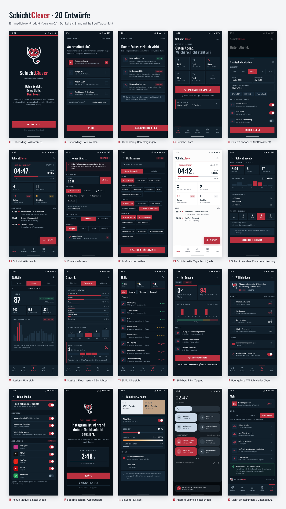

# SchichtClever – Entwurfsbilder

20 Screens, 412 × 892 dp, gerendert mit 2× (824 × 1784 px). Quellen in `src/`, neu erzeugen mit `cd src && node render.js`.

Stil: mediclever (Rot #B9303F, Dunkel #11202C, Oswald + Roboto, eckige Kanten). Dunkel ist Standard, Tagschichten hell.

| Nr. | Screen | Beschreibung |
|---|---|---|
| 01 | [Onboarding: Willkommen](png/01-onboarding-willkommen.png) | Begrüßung mit Cleverle und dem Versprechen der App in einem Satz. |
| 02 | [Onboarding: Rolle wählen](png/02-onboarding-rolle.png) | Die Rolle bestimmt den vorgeschlagenen Maßnahmen-Katalog und die Schichtvorlagen. |
| 03 | [Onboarding: Berechtigungen](png/03-onboarding-berechtigungen.png) | Jede Android-Berechtigung wird mit ihrem konkreten Zweck erklärt, nichts verlässt das Gerät. |
| 04 | [Schicht: Start](png/04-schicht-start.png) | Ohne aktive Schicht: Vorlage wählen und mit einem Tipp starten. |
| 05 | [Schicht anpassen (Bottom-Sheet)](png/05-schichtwahl-sheet.png) | Vor dem Start lassen sich Typ, Beginn, Fahrzeug oder Station und die Automatik einstellen. |
| 06 | [Schicht aktiv: Nacht](png/06-schicht-aktiv-nacht.png) | Laufende Nachtschicht mit Fortschritt, Kennzahlen, Status der Automatik und Einsatz-Zeitleiste. |
| 07 | [Einsatz erfassen](png/07-einsatz-erfassen.png) | Schnelle Erfassung mit vorbelegter Alarmzeit, Kategorie, Dringlichkeit und Ausgang, ohne Patientendaten. |
| 08 | [Maßnahmen wählen](png/08-massnahmen-waehlen.png) | Gruppierter Maßnahmen-Katalog mit Suche, Mehrfachauswahl und Rolle selbst oder assistiert. |
| 09 | [Schicht aktiv: Tagschicht (hell)](png/09-schicht-aktiv-tag-hell.png) | Frühdienst auf Station im hellen Design: dieselbe Struktur, für Tageslicht angepasst. |
| 10 | [Schicht beenden: Zusammenfassung](png/10-schicht-beenden.png) | Bilanz der Schicht mit Kennzahlen, häufigsten Maßnahmen, Stimmung und Notiz; Fokus und Filter enden. |
| 11 | [Statistik: Übersicht](png/11-statistik-uebersicht.png) | Einsätze, Stunden und Maßnahmen im Zeitraum plus Verteilung nach Uhrzeit mit markiertem Peak. |
| 12 | [Statistik: Einsatzarten & Schichten](png/12-statistik-arten-schichten.png) | Verteilung der Kategorien, Durchschnitt je Schichttyp und Serie der Nachtschichten. |
| 13 | [Skills: Übersicht](png/13-skills-uebersicht.png) | Alle Maßnahmen mit Häufigkeit, letztem Mal und einer Ampel, wie frisch der Skill ist. |
| 14 | [Skill-Detail: i.o.-Zugang](png/14-skill-detail-io.png) | Verlauf eines einzelnen Skills mit Ziel-Intervall, Übungsliste und manuellen Einträgen für Training. |
| 15 | [Übungsliste: Will ich wieder üben](png/15-uebungsliste.png) | Persönliche Liste mit Zieldaten, Erinnerung und einem dezenten Hinweis von Cleverle. |
| 16 | [Fokus-Modus: Einstellungen](png/16-fokus-einstellungen.png) | Automatischer Fokus mit „Nicht stören“, Ausnahmen für Anrufe und einer Liste pausierter Apps. |
| 17 | [Sperrbildschirm: App pausiert](png/17-sperrbildschirm.png) | Overlay, wenn eine pausierte App geöffnet wird, mit Restzeit und bewusster Kurzfreigabe. |
| 18 | [Blaufilter & Nacht](png/18-blaufilter.png) | Intensität, Farbtemperatur, Zeitplan und Dimmung mit Live-Vorschau. |
| 19 | [Android-Schnelleinstellungen](png/19-schnelleinstellungen.png) | Drei SchichtClever-Kacheln im System-Panel: Schicht, neuer Einsatz und Fokus. |
| 20 | [Mehr: Einstellungen & Datenschutz](png/20-mehr-einstellungen.png) | Profil, Design-Automatik, Maßnahmen-Katalog, Export und das Versprechen „nur auf diesem Gerät“. |
